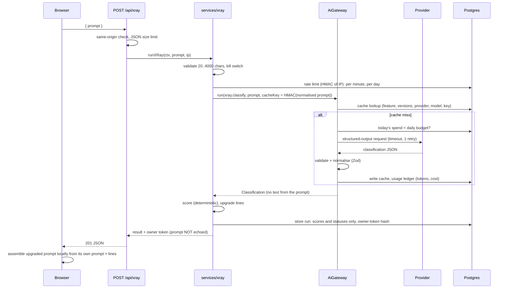

# Architecture

VibeAcademy is one Next.js application with strict internal boundaries, one Postgres schema, and one controlled pathway to AI models. It is sized for a solo founder working with AI agents: cheap to run, simple to deploy, easy to reason about.

## Layers and boundaries

```mermaid
flowchart LR
  subgraph Browser
    UI[components/*<br/>client islands]
  end
  subgraph "Next.js server (one app)"
    Routes[app/* pages + api/*]
    Services[server/services<br/>xray, waitlist, open-metrics]
    Gateway[server/ai/gateway<br/>the only model pathway]
    Domain[domain/*<br/>pure: taxonomy, scoring,<br/>prompt upgrade, build pack]
    Content[content loaders]
    DB[(Postgres<br/>PGlite in dev/test)]
  end
  Provider[[Analysis provider<br/>rule-based (default) or Anthropic (deferred)]]
  YAML[/content/*.yaml/]

  UI -->|fetch JSON| Routes
  Routes --> Services
  Routes --> Content
  Services --> Domain
  Services --> Gateway
  Services --> DB
  Gateway --> Provider
  Gateway --> DB
  Content --> YAML
  UI -.imports pure code.-> Domain
```

| Layer | May import | Must not import | Enforced by |
| --- | --- | --- | --- |
| `src/domain` | zod, other domain modules | React, Next, Node APIs, server, content, components | ESLint `no-restricted-imports` |
| `src/server` | domain, its own modules | components, app | `server-only` import, review |
| `src/content` | domain, Node fs | components | `server-only` |
| `src/components` | domain, ui, lib | server, content | ESLint |
| `src/app` | everything | | |

Why one app and not a monorepo: see [ADR 0001](decisions/0001-single-app.md).

## The X-Ray request, step by step



## Key modules

| Module | Responsibility |
| --- | --- |
| `src/domain/taxonomy/` | 12 domains, 36 decisions (weights, critical flags, applicability, classifier criteria, prompt lines), chapters, depths, ranks, app traits. `TAXONOMY_VERSION`. |
| `src/domain/xray/classification.ts` | Model output schema (strict) and lenient normaliser (casing, unknown ids, missing decisions). |
| `src/domain/xray/scoring.ts` | Deterministic score, bands, critical cap, per-domain coverage, top risks. `SCORING_VERSION`. |
| `src/domain/xray/prompt-upgrade.ts` | Builds the upgraded prompt from decision prompt lines. No AI. |
| `src/domain/blueprint/build-pack.ts` | Blueprint types (Phase 1 shape) and the AGENTS.md renderer shared by X-Ray and Blueprint. |
| `src/domain/content/*-schema.ts` | Zod schemas for Decision Cards and Lab content (the honesty rules live here). |
| `src/server/env.ts` | The only reader of environment variables. Provider selection and production safety rules. |
| `src/server/ai/` | `gateway.ts` (pathway), `types.ts` (seams), `providers/` (`rules.ts`, the default rule-based check; `anthropic.ts`, deferred), `features/` (X-Ray classify), `pricing.ts`. |
| `src/server/db/` | Drizzle schema, client factory (PGlite or postgres-js), migrations in `/drizzle`. |
| `src/server/services/` | Product operations with validation, limits and events. |
| `src/server/security/` | HMAC, tokens, rate limiting. |

## Data model

Phase 0 tables (`src/server/db/schema.ts`): `xray_runs`, `ai_cache`, `ai_usage`, `rate_limits`, `waitlist_entries`, `events`. None stores prompt text. See [privacy.md](privacy.md) for the column-level inventory.

Phase 1 additions (designed, not built). Create them in one migration when M2 starts:

| Table | Key columns | Notes |
| --- | --- | --- |
| `users` | id, email, display_name, locale, rank, default_depth, created_at | Owned by the auth library's tables or linked to them (see ADR 0010). |
| `projects` | id, user_id, name, app_type, traits (jsonb), chapter, taxonomy_version | One learner, many apps. |
| `project_decisions` | project_id, decision_id, card_slug, card_version, option_key, prompt_line, decided_at | The Blueprint. Matches `BlueprintDecision` in `build-pack.ts`. Unique (project_id, decision_id). |
| `card_progress` | user_id, card_slug, depth_reached, proven_at | Powers the Decision Deck. |
| `build_pack_exports` | id, project_id, files (jsonb), generated_at | Every export is a version. |
| `xp_events` | id, user_id, kind, ref, created_at | Append-only; ranks and badges are computed. |
| `subscriptions` | user_id, provider, provider_ref, plan, status, period_end | Written only by payment webhooks. |
| `credit_ledger` | id, user_id, delta, reason, created_at | Append-only. |

Also link `xray_runs.user_id` (nullable) so signed-in learners can keep their X-Ray history and start a project from a result.

## AI layer

- **Provider seam** (`AiProvider`): `generate(request) -> { json, usage, model }`. Anthropic implementation uses the Messages API with `output_config.format` JSON schema (structured outputs, no beta header). The `rules` provider (keyword rules) is the default engine in every environment and is labelled "Rule-based check"; the Anthropic provider is a deferred placeholder used only with `AI_PROVIDER=anthropic` (ADR 0011).
- **Feature seam** (`AiFeature`): owns its system prompt, user-message wrapper, Zod schema, JSON schema, version, output token cap and cache TTL.
- **Gateway**: provider check, cache (keyed by feature, prompt version, content version, provider, model and input HMAC), daily budget, timeout (25 s), one retry on 429/5xx/timeouts, validation, cache write, usage ledger including failures and cache hits.
- **Product limits** (per-visitor rate limits, kill switches) live in services because they apply even to cache hits.
- **Cost**: Haiku 5.5 at $0.10 / $0.50 per million tokens (input / output). An X-Ray classification is roughly 3,000 to 4,000 input tokens (system prompt with 36 decision criteria, prompt, structured-output overhead) and under 1,000 output tokens: an estimated $0.0005 to $0.001 per uncached analysis. Measure the real number before switching AI on (roadmap, "Later: AI features") and publish it on `/open`.

## Security posture

- Security headers on every response (CSP, frame denial, nosniff, referrer policy, permissions policy, HSTS in production). CSP still allows inline scripts for Next.js hydration; moving to nonces is in M2.
- Same-origin check on every state-changing API call; JSON-only bodies capped at 16 KB.
- Zod validation on every input and on model output.
- HMAC (with `HASH_SECRET`) for prompts and IPs; owner tokens are random, stored only as SHA-256 hashes, compared in constant time.
- Rate limits per hashed IP; daily AI budget; kill switches per feature.
- Production refuses to start without `HASH_SECRET`. Paid AI runs only when `AI_PROVIDER=anthropic` is set explicitly.
- Future Reality Check: ownership verification (DNS TXT or a file) and passive checks only. Hard requirement.

## Deployment (recommended, not yet done)

- App: Vercel or any Node 22 host (Render, Fly.io, Railway). `pnpm build && pnpm start`.
- Database: Neon or Supabase Postgres. Set `DATABASE_URL` (pooled connection), run `pnpm db:migrate` on each deploy.
- Required env in production: `HASH_SECRET`, `DATABASE_URL`, `NEXT_PUBLIC_SITE_URL`. `ANTHROPIC_API_KEY` and `AI_DAILY_BUDGET_USD` matter only once AI is switched on.
- Behind a proxy that sets `x-forwarded-for` (all of the above do); rate limiting relies on it.
- Phase 2 can move the database and a scan worker to AWS with Terraform; the founder's DevOps background makes this good public content, but only when traffic or cost justify it.
